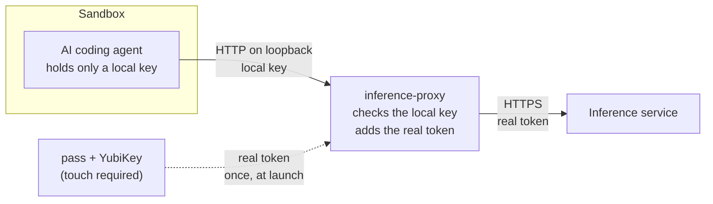

<!--
    Copyright (c) 2026 ETH Zurich

    SPDX-License-Identifier: BSL-1.0
    Distributed under the Boost Software License, Version 1.0. (See accompanying
    file LICENSE_1_0.txt or copy at http://www.boost.org/LICENSE_1_0.txt)
-->

# inference-proxy

A loopback HTTP proxy that lets a sandboxed AI coding agent (e.g. Claude Code) use an inference
API **without ever holding the real token**.



The proxy reads the real token once on stdin and keeps it in memory only. The agent gets a random
per-launch key that only works against this proxy instance, on this machine. Run one instance
per inference service.

It is meant to be used together with [restrict_llm](https://github.com/aurianer/restrict_llm),
which provides the sandbox (a dedicated user, bubblewrap and seccomp). The
`claude-via-inference-proxy` launcher in this repo starts the proxy, then Claude Code in that
sandbox.

## Recommended: keep the token on a YubiKey with touch enforced

The proxy protects the token while it is in use. Protect it at rest too:

- Store the token in [pass](https://www.passwordstore.org/), encrypted to an OpenPGP key that
  lives on a YubiKey.
- Enforce touch for decryption, so nothing can read the token without your finger on the key.
  Set it after generating the key, since generating one resets the policy:
  ```bash
  ykman openpgp keys set-touch dec fixed
  ```
- Do not mount the password store or `~/.gnupg` in the sandbox. A touch does not show which
  entry is being decrypted.

## What it does

- Listens on `127.0.0.1` only, on a kernel-chosen port that it prints as `port=<n>` on stdout,
  so no other local process can squat a known port and pose as the proxy.
- Accepts only `GET` and `POST` on plain paths under `/v1/`, and checks the local key in
  constant time before sending anything upstream.
- Forwards only an allowlist of request headers (`accept*`, `content-type`, `user-agent`,
  `x-app`, `anthropic-*`, `x-stainless-*`, `x-claude-code-*`), then adds the real token.
- Connects over TLS, with certificate verification, to the single `--upstream` host. The client
  cannot choose another one.
- Relays responses byte for byte, so streaming works.
- Logs one line per request (method, path, status), never headers or bodies.
- Exits when its parent process dies, and marks itself non-dumpable: no core dump, and no memory
  access by other processes of the same user.

## Usage

```bash
claude-via-inference-proxy <upstream-url> <pass-entry> <bearer|x-api-key> [claude args]
```

The launcher generates the local key, starts the proxy, lets `pass` write the token straight
into it, then runs restrict_llm's `/usr/local/bin/claude-sandboxed` with `ANTHROPIC_BASE_URL`
and `ANTHROPIC_AUTH_TOKEN` set to the proxy address and the local key. Other environment
variables (`CLAUDE_CONFIG_DIR`, `ANTHROPIC_MODEL`, ...) are passed through to Claude Code.

To drive the proxy from another launcher, use
[claude-via-inference-proxy](claude-via-inference-proxy) as the reference:

- stdin: line 1 is the local key (at least 32 printable characters), line 2 is the real token.
  Further lines are ignored.
- stdout: one line, `port=<n>`, once the proxy is listening.

| Option | Meaning |
|---|---|
| `--upstream` | `https://host[:port][/base-path]`, required |
| `--auth` | How the upstream expects the token: `bearer` (default) or `x-api-key` |
| `--port` | Fixed port, for debugging only; another local process can take it first |

## Build and install

Use the latest stable Rust, to have all the security patches, installed root-owned so the
sandbox cannot modify it: see [docs/install-rust.md](docs/install-rust.md).

```bash
cargo build --release --locked
cargo test --locked
PROXY_BIN=target/release/inference-proxy python3 -m unittest discover -s tests
sudo install -o root -g root -m 755 target/release/inference-proxy /usr/local/bin/
sudo install -o root -g root -m 755 claude-via-inference-proxy /usr/local/bin/
```

`--locked` builds exactly the versions in `Cargo.lock`, with checksums verified by cargo. Build
from a checkout the sandbox cannot write to, and install the binary root-owned.

## Dependencies

| Crate | Why |
|---|---|
| `rustls` (ring backend) | TLS to the upstream; memory-safe, no OpenSSL |
| `rustls-native-certs` | Trust the system CA store (honours `SSL_CERT_FILE`) |
| `httparse` | Strict HTTP/1.x request parsing, no dependencies |
| `zeroize` | Wipe the key and token from memory when dropped |
| `libc` | Two `prctl` calls at startup (`PR_SET_DUMPABLE`, `PR_SET_PDEATHSIG`) |

No async runtime and no HTTP framework: one thread per connection, with a cap on concurrent
connections.

## Limitations

- The client can still use the service through the proxy while it runs.
- Any local process that learns the local key can use the proxy too.
- A hostile client can make the proxy buffer about 1 GiB of request bodies.
- Wiping memory is best effort: the kernel and the TLS library may hold transient copies.

## License

Distributed under the Boost Software License, Version 1.0. See
[LICENSE_1_0.txt](LICENSE_1_0.txt).
